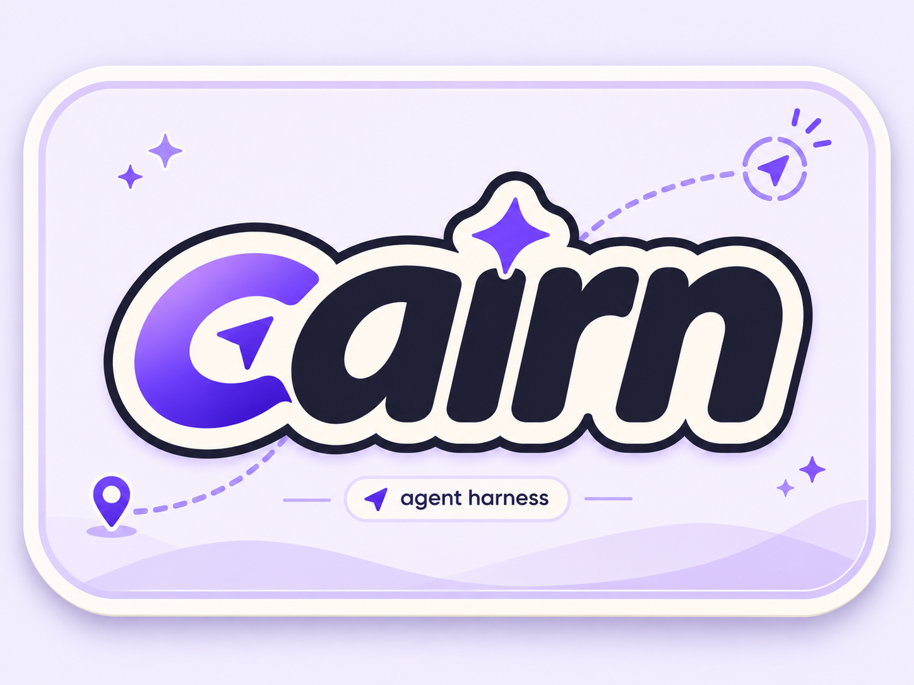

<p align="center">
  
</p>

Cairn is a personal Agent for Debian servers. A shared Runtime runs the Agent;
CLI, Web and WeChat clients can use the same Conversation/Run identity, progress,
history and (for explicit development) Git Worktree. LangGraph orchestrates model calls and tools through the existing
`run_turn` implementation.

```text
Interactive CLI ─┐
Web Chat ────────┼── Shared Runtime ── LangGraph model ↔ tools ── answer
WeChat bridge ──┘        │
                   tasks / history / recovery / worktrees
```

Ordinary chat creates durable Conversation and Run facts in the DomainStore,
uses read-only tools without allocating a Task or Worktree, and never appears in
TaskBoard. Explicit development remains on the compatibility task path during
B2; it creates a Worktree and TaskBoard card under the existing safety rules, and
the complete Task lifecycle move is B3. The service persists state, enforces host
permissions and budgets, and retains work for safe continuation.

## Install

Requires Python 3.12+ and [uv](https://docs.astral.sh/uv/). Development tasks need
Git 2.40+ for Worktree operations. Durable storage also checks the SQLite library
linked to Python; see [operations](docs/guides/pilot-runbook.md).

```sh
git clone https://github.com/CaiusLuo/cairn.git
cd cairn
uv sync --locked --all-groups
```

For real models, configure `.env` or `.cairn/models.toml` using
[configuration](docs/configuration.md). The offline example below needs no model
credentials and makes no paid API requests.

## Start Cairn Server

After preparing your model configuration, build Web and start the background
service on Debian:

```sh
pnpm --dir web install --frozen-lockfile
pnpm --dir web build
sudo ./scripts/start.sh
```

On first use, the script creates missing `/etc/cairn/config.toml`, provider
approval and systemd unit files. It reuses your `.env` and `.cairn/models.toml`,
checks configuration and Web assets, and reports the running PID. Existing host
files are preserved. `sudo ./scripts/end.sh` reports the PID and stops the service.
Foreground debugging remains `uv run cairn --config /etc/cairn/config.toml`.

For an unpaid offline smoke test, remove `provider_approval` and set
`offline = true`. Production never silently falls back to an offline model.
From the configured workspace, connect the independent client:

```sh
uv run cairn-cli --config /etc/cairn/config.toml
```

Open `http://127.0.0.1:8777/chat.html`; username is `cairn`, password is
`data_root/runtime/runtime.token`. One sign-in lasts 30 days and survives
service restarts; the browser cookie is backed by hashed sessions in
`data_root/runtime/web-sessions.json`. The Web Workbench shares this Server for conversations, development tasks, run
history, execution recovery and private knowledge clips. Settings manages WeChat, schedules and memory. Knowledge clips
are stored outside the Agent workspace and are never injected into ordinary Agent turns or `MEMORY.md`. Use an SSH tunnel for a remote server.

Daily reviews are generated from the day's clips, Task/Run receipts and personal journal through
`POST /api/knowledge/reviews/daily`; `GET /api/knowledge/reviews` and
`GET /api/knowledge/reviews/{id}` return the persisted report, its source manifest and the bounded redacted
source snapshots used at generation time. Archived clips are excluded. Generation uses one
restricted provider call with no tools and sends only a bounded, redacted source snapshot. Repeated requests
with the same `request_id`, date, timezone and regeneration mode are idempotent even if sources changed in
between; a reused id with different intent is rejected. A completed report is never overwritten, and explicit
regeneration creates a new version.

The Server also schedules the daily review itself at 20:30 `Asia/Shanghai`, covering the contiguous window
from the previous day's cutoff, and catches up a missed cutoff after restart. Set `review_schedule = false`
under `[services]` to disable it. A scheduled completed review gets a durable delivery record: it is pushed
to WeChat as plain mobile-sized text once a logged-in account and recipient context are available, and stays
pending otherwise. `POST /api/knowledge/reviews/{id}/delivery/resend` retries an `unconfirmed` or
`manual_review` delivery after inspection; pass `{"rebind": true}` after switching accounts. Delivery never
changes the review's completed state, and an attempt whose result is unknown is never resent automatically.

Chat normally, or enter `/develop GOAL`. `/status`, `/history`, `/cancel`,
`/new` and `/use CONVERSATION_ID` operate on the same server-owned Conversation;
`/continue` and development task controls remain on the explicit development path.
`/use TASK_ID` and `/task use TASK_ID` switch the client to that explicit Task,
while `/use RUN_ID` selects a Conversation Run; appended input keeps the selected
Task, Session and Worktree.
Conversation creation and messages accept a stable `request_id`; retries return
the original Conversation/Run and never fork a duplicate. A Development Task
created from Web or CLI can be continued from either entry by Task ID. Each
appended input keeps its own `request_id`, and the Task exposes durable per-input
receipts with the settled event sequence, result excerpt and retained
Session/Worktree identity. Paused and completed Tasks accept another input in
place; active turns and recovery-required Tasks are refused with distinct
conflict responses, and failed/cancelled Tasks require a new Task.
Run cancellation is a `POST /api/runtime/runs/{run_id}/cancel`; recovery review uses
`GET /api/runtime/runs/{run_id}/recovery` and
`POST /api/runtime/runs/{run_id}/reconcile`.
`/wx` starts login;
`/wx status` and `/wx verify CODE` manage it. Web Settings offers these same
controls plus Schedule and Memory. Client exit leaves background services running.

The [Server guide](docs/guides/runtime-service.md) covers configuration priority,
persistent files, explicit backed-up data import, provider authorization and
systemd operation. `./scripts/start.sh` supports `start`, `stop`, `restart`, `status` and
`logs`; supervision belongs to systemd. Host setup and service operations need
root or equivalent systemd rights.
Standalone CLI/WeChat Runtime launchers have been retired.

One task worker and a bounded queue remain. Ordinary chat facts use SQLite
DomainStore; development execution still uses the RuntimeCatalogue compatibility
representation until B3. Durable Sessions use SQLite. Tool permissions,
credential filtering, LangGraph execution and uncertain-effect recovery remain
active. Run events are delta-batched and replayed from an `after` cursor. Web
Chat and CLI consume pages until the true final sequence; WebSocket clients
reconnect with the same cursor and receive a bounded preview snapshot for
in-flight text. Offline migration is available through the `migrate-domain`
command with backup and source snapshot checks. PostgreSQL and parallel workers
remain outside this change.

## Development

Use current code and behavioral tests to guide changes. Architecture and storage
can evolve with the product; this documentation describes the implementation.

```sh
uv run ruff check .
uv run ruff format --check .
uv run mypy src tests
```

Run the regression tests for the code you change; the full offline suite is
`uv run pytest`. [Tests](tests/README.md) and
[operational scripts](scripts/README.md) have their own short indexes.
[Documentation](docs/README.md) covers configuration, running and recovery.
