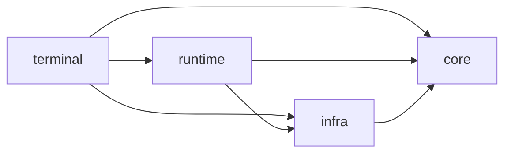

# Architecture

Cairn uses four package areas to keep contracts, execution, external systems and
the command line easy to locate. They describe dependency direction, not a
requirement that every use case pass through an abstract interface.

Arrows point from a package to its allowed dependencies:

`core` owns domain models, policies and interfaces. It may import only other
`core` modules, and must not import provider SDKs or process, network and
persistence modules. `infra` implements external capabilities and may import
`core` and `infra`. `runtime` composes those capabilities and owns execution; it
may import `core`, `infra` and `runtime`. `terminal` is the command-line adapter
and may compose all three.

`tests/core/test_architecture.py` enforces both the direction and the `core`
import rule. There are no compatibility modules preserving obsolete package
paths; see [ADR 0001](adr/0001-modular-architecture-baseline.md) for why.

## Execution ownership

The CLI enters through `cairn.terminal.cli`; `cairn.runtime.assembly` builds the
session's Agent and its dependencies. `cairn.runtime.loop.run_turn` is the single
owner of the Agent turn: it handles failures and finalizes the turn, delegating
root/per-attempt spans, usage and the final trace event to
`cairn.runtime.turn_trace.TurnTrace`. Calls inside an accepted assistant response
are executed by `cairn.runtime.tool_execution`, which owns preflight, permission evaluation,
execution authority, model-facing tool messages and per-tool spans. `run_turn`
keeps sole ownership of conversation rollback and of which calls are still
pending when a turn aborts.

`ModelExecutor` selects the matching model, token counter and provider runtime for
each candidate, builds that candidate's request, and returns `(request, response)`.
It does not own turn tracing, turn error finalization or turn lifecycle.

Task, workflow, review and evaluation code in `cairn.runtime` provide bounded
orchestration around Agent turns. They do not create a second general Agent loop.
Existing scheduling and retry behavior belongs with the runtime flow that uses it.
Infrastructure supplies capabilities such as model clients, filesystem/worktree
operations, GitHub transport and trace storage; it does not decide when a task or
turn should run.

## Cancellation

Work the harness owns is allowed to finish its cleanup when the caller cancels,
and repeated cancellation never interrupts that cleanup.
`cairn.runtime.lifecycle.settle_owned` cancels abandoned runtime work and observes
its outcomes; `await_owned` finishes cleanup without cancelling it. Each caller
keeps ownership of its primary error, result and late cancellation policy.

`infra` may not import `runtime`, so infrastructure keeps its own narrower
policies: `infra.git.cleanup.finish_cleanup` protects worktree release and Git
inspection cleanup from repeated cancellation. Inspection owns the spawn task,
restarts pipe drains when stopping, reaps the process, then settles its readers;
the original cancellation or failure remains primary.
`infra.tools.bash._settle_collection` bounds collection cleanup with a timeout.
These policies remain separate; see
[known limitations](#known-limitations).

## Package guide

| Area | Put here |
| --- | --- |
| `cairn.core` | Agent-facing contracts and stable domain data, including LLM, task, memory and repository models |
| `cairn.runtime` | Agent/turn execution and the tool-call boundary, assembly, model selection at execution time, and bounded task, workflow, review, evaluation and memory orchestration |
| `cairn.infra` | Configuration, provider implementations, token counting, tools, Workspace and Git operations, GitHub transport, RepoGraph and observability storage |
| `cairn.terminal` | CLI startup, terminal input/output and user commands |
| `cairn.resources` | Packaged static resources such as the terminal banner |

When adding a feature, put its domain types in `core` only when they are
meaningful independently of a particular adapter. Put operating-system,
provider, network, persistence or process details in `infra`. Put sequencing,
admission, retries and coordination in the runtime that owns the operation. Add
CLI parsing and presentation in `terminal`. Keep the narrowest useful boundary;
do not add ports or adapters where a direct dependency is already clear and
stable.

## Where mutable state lives

| State | Owner |
| --- | --- |
| Conversation messages | `core.state.AgentState`, held by one `runtime.agent.Agent` |
| Session model selection and grants | `core.model_manager` and `core.permissions.SessionPermissionHandler` |
| Active provider runtime | `runtime.provider_runtime.ProviderSession`, committed through `commit`; terminal command context observes the committed runtime |
| Per-model failure notes for `/model list` | `runtime.model_executor.ModelExecutor` |
| Turn spans and usage | `runtime.turn_trace.TurnTrace`, finalized by `run_turn` |
| Task status and results | `runtime.tasks.CodingTaskRunner` |
| EvalCase observations | `runtime.evals.runner.EvalRunner.run` binds, resets and finalizes one compatible metrics record; completed results hold detached snapshots |
| Workflow and review progress reports | `_Progress` in each workflow, persisted atomically |
| Worktree lifecycle | `infra.git.worktree.WorktreeHandle` |

## Integration entry points

| Operation | Entry point and owner |
| --- | --- |
| Build an Agent | `runtime.assembly.build_agent` composes capabilities for an explicit Workspace |
| Execute a Turn | `runtime.loop.run_turn` owns conversation recovery and invokes tool execution and telemetry |
| Run a coding Task | `runtime.tasks.CodingTaskRunner.run` owns task state around the same Turn boundary |
| Verify a change | `runtime.workflow.verification.FixedChecksVerifier.verify` evaluates host-supplied checks; the workflow binds evidence to its Git snapshot and rechecks drift |
| Execute review | `runtime.review.workflow.ReviewWorkflow.run` owns bounded verification, review and repair progress |
| Read repository facts | `infra.repo_graph.RepoGraphBuilder` returns bounded candidates and retains complete historical snapshots |
| Read/write Project Memory | `runtime.memory.retrieval.MemoryReader` retrieves scoped evidence; `runtime.memory.service.MemoryService` owns transitions behind trusted-host approval |
| Run an EvalSuite | `runtime.evals.suite.EvalSuiteRunner.run` owns the report; `EvalRunner` owns each temporary workspace and deterministic checks |

Future durable transitions belong at the existing runtime owner's boundaries.
Filesystem, database and remote effects belong in infrastructure; a scheduler
or persistence integration should call these owners rather than advance a second
task/turn lifecycle.

## Extension seams for the next milestones

- Durable sessions and checkpoint/resume: a turn boundary (`run_turn`) and a
  tool-call boundary (`tool_execution`) already exist to checkpoint around;
  `AgentState` is the conversation owner to serialize.
- Typed retry, timeout and idempotency: model fallback lives in `ModelExecutor`,
  task-level cancellation in `lifecycle`, and workflow timeouts at their call
  sites.
- Task queue and DAG scheduling: `CodingTaskRunner` and the workflow runners own
  their lifecycles; a scheduler should call them rather than duplicate them.
- MCP and external tools: `infra.tools` and `infra.tools.registry` own tool
  contracts and registration; permission decisions stay in `core.permissions`.

## Known limitations

- `core.models.ToolResult` is a subprocess-shaped contract (`stdout`, `stderr`,
  `exit_code`). Non-shell tools must fit it, and a richer structured result has no
  core representation yet. Changing this touches every tool and is deferred until
  a tool actually needs it.
- `core.permissions` knows the `bash` tool name and its argument keys. This is a
  deliberate, narrow guardrail that runs after the tool validates its arguments,
  so the coupling is documented rather than removed.
- `core.events.Event.data` is an untyped mapping rendered and consumed by string
  key. A typed payload per event would be a real improvement, but no consumer
  needs it yet.
- Cancellation settlement exists in runtime and infrastructure because `infra`
  may not import `runtime`. Runtime distinguishes abandoning work from finishing
  cleanup, Git protects owned cleanup, and Bash bounds collection settlement.
  Sharing a mechanism does not make the callers' result and propagation policies
  interchangeable.
- `runtime/review/git.py` and `runtime/workflow/git.py` each compute a
  filesystem identity tuple. The duplication is nine mechanical lines; making it
  public would widen an API for no second behaviour.

## References

The package boundaries are Cairn's own pragmatic organization. Two useful
external examples are [mini-swe-agent's source tree](https://github.com/SWE-agent/mini-swe-agent/tree/main/src/minisweagent),
which separates agents, models, environments, run logic and utilities, and
[`pydantic-ai`'s package](https://github.com/pydantic/pydantic-ai/tree/main/pydantic_ai_slim/pydantic_ai),
which separates agents, models, providers, toolsets, workspaces and its CLI.
The useful lesson is to make execution, provider/environment details and entry
points findable; these projects do not prescribe Cairn's exact layer layout.
