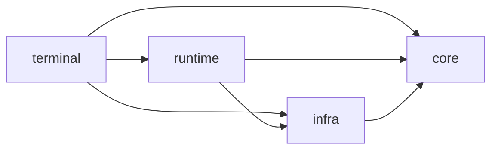

# Architecture

Cairn uses four package areas to keep policy, execution, external systems and
the command line easy to locate. They describe dependency direction, not a
requirement that every use case pass through an abstract interface.

Arrows point from a package to its allowed dependencies:

`core` owns domain models, policies and interfaces. It may import only other
`core` modules. `infra` implements external capabilities and may import `core`
and `infra`. `runtime` composes those capabilities and owns execution; it may
import `core`, `infra` and `runtime`. `terminal` is the command-line adapter and
may compose all three. Keep dependency direction visible in imports; avoid
introducing compatibility modules that preserve obsolete package paths.

## Turn and orchestration ownership

The CLI enters through `cairn.terminal.cli`; `cairn.runtime.assembly` builds
the session's Agent and its dependencies. `cairn.runtime.loop.run_turn` is the
single owner of the Agent turn: it records spans, handles failures and usage,
and finalizes the turn. `ModelExecutor` selects the matching model, token
counter and provider runtime for each candidate, builds that candidate's
request, and returns `(request, response)`. It does not own turn tracing,
turn error finalization or turn lifecycle.

Task, workflow, review and evaluation code in `cairn.runtime` provide bounded
orchestration around Agent turns. They do not create a second general Agent
loop. Existing scheduling and retry behavior belongs with the runtime flow
that uses it. Infrastructure supplies capabilities such as model clients,
filesystem/worktree operations, GitHub transport and trace storage; it does
not decide when a task or turn should run.

## Package guide

| Area | Put here |
| --- | --- |
| `cairn.core` | Agent-facing contracts and stable domain data, including LLM, task, memory and repository models |
| `cairn.runtime` | Agent/turn execution, assembly, model selection at execution time, and bounded task, workflow, review, evaluation and memory orchestration |
| `cairn.infra` | Configuration, provider implementations, token counting, tools, Workspace and Git operations, GitHub transport, RepoGraph and observability storage |
| `cairn.terminal` | CLI startup, terminal input/output and user commands |
| `cairn.resources` | Packaged static resources such as the terminal banner |

When adding a feature, put its domain types in `core` only when they are
meaningful independently of a particular adapter. Put operating-system,
provider, network, persistence or process details in `infra`. Put sequencing,
admission, retries and coordination in the runtime that owns the operation.
Add CLI parsing and presentation in `terminal`. Keep the narrowest useful
boundary; do not add ports or adapters where a direct dependency is already
clear and stable.

## Prior package paths

The package move makes the following new paths canonical:

| Previous path | Canonical path |
| --- | --- |
| `cairn.assembly` | `cairn.runtime.assembly` |
| `cairn.cli` | `cairn.terminal.cli` |
| `cairn.config` | `cairn.infra.config` |
| `cairn.repository` | `cairn.infra.git.context` (`RepositoryEvidence` is `cairn.core.repository`) |
| `cairn.core.agent`, `cairn.core.loop` | `cairn.runtime.agent`, `cairn.runtime.loop` |
| `cairn.llm.base`, `cairn.llm.model_manager`, `cairn.llm.provider_catalog` | `cairn.core.llm`, `cairn.core.model_manager`, `cairn.core.provider_catalog` |
| `cairn.llm.model_executor`, `cairn.llm.provider_runtime` | `cairn.runtime.model_executor`, `cairn.runtime.provider_runtime` |
| `cairn.llm.litellm_client`, `cairn.llm.token_counter` | `cairn.infra.llm.litellm_client`, `cairn.infra.llm.token_counter` |
| `cairn.tasks.models`, `cairn.tasks.runner` | `cairn.core.tasks`, `cairn.runtime.tasks.runner` |
| `cairn.workflow`, `cairn.review`, `cairn.evals` | `cairn.runtime.workflow`, `cairn.runtime.review`, `cairn.runtime.evals` |
| `cairn.github.publisher` | `cairn.runtime.workflow.publisher` |
| `cairn.github`, `cairn.git`, `cairn.tools`, `cairn.workspace` | `cairn.infra.github`, `cairn.infra.git`, `cairn.infra.tools`, `cairn.infra.workspace` |
| `cairn.observability`, `cairn.repo_graph` | `cairn.infra.observability`, `cairn.infra.repo_graph` |
| `cairn.memory.models`, `cairn.memory.context` | `cairn.core.memory.models`, `cairn.core.memory.context` |
| `cairn.memory.filesystem`, `cairn.memory.identity`, `cairn.memory.store` | `cairn.infra.memory.filesystem`, `cairn.infra.memory.identity`, `cairn.infra.memory.store` |
| `cairn.memory.evidence`, `cairn.memory.freshness`, `cairn.memory.retrieval`, `cairn.memory.service` | `cairn.runtime.memory.evidence`, `cairn.runtime.memory.freshness`, `cairn.runtime.memory.retrieval`, `cairn.runtime.memory.service` |

Update imports to the canonical paths when touching examples or integrations;
there are no legacy wrapper modules. Test organization and commands are in
[tests/README.md](../tests/README.md).

## References

The package boundaries are Cairn's own pragmatic organization. Two useful
external examples are [mini-swe-agent's source tree](https://github.com/SWE-agent/mini-swe-agent/tree/main/src/minisweagent),
which separates agents, models, environments, run logic and utilities, and
[`pydantic-ai`'s package](https://github.com/pydantic/pydantic-ai/tree/main/pydantic_ai_slim/pydantic_ai),
which separates agents, models, providers, toolsets, workspaces and its CLI.
The useful lesson is to make execution, provider/environment details and entry
points findable; these projects do not prescribe Cairn's exact layer layout.
